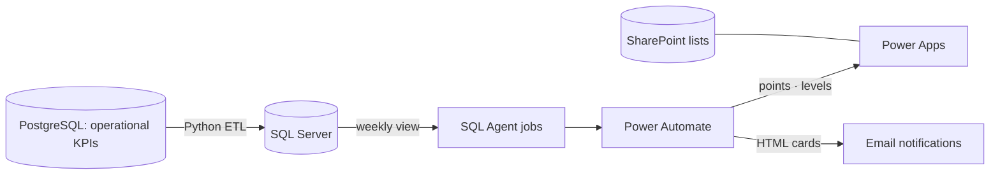

# 🎮 Employee Gamification Platform

> A Scalify Panama solution that turns weekly KPIs into points, coins, levels and rewards, so performance becomes visible and fun.

| | |
|---|---|
| **Type** | Enterprise platform (Power Apps + Power Automate + SQL data pipeline) |
| **Status** | 🟢 In production at a BPO / contact-center operation |
| **Users** | Front-line employees, team leads, operations management |
| **My role** | Solution designer, data engineer, Power Platform developer |
| **Source** | Private |

---

## 🎯 The problem
Weekly performance data (QA scores, production and staffing KPIs) lived in separate systems, and employees rarely saw it. Recognition was manual and inconsistent.

## ✅ The solution
Five modules in a single Power Apps experience:

| Module | What it does |
|---|---|
| 📊 **Stats** | Weekly KPIs converted into points automatically |
| 🎯 **Missions** | Goals and challenges that award bonus points |
| 👏 **Kudos** | Peer-to-peer recognition |
| 🛒 **Store** | Spend earned coins on rewards |
| 🏆 **Leaderboard** | Rankings and levels |

Automated notifications celebrate **level-ups, birthdays, work anniversaries and new hires**.

---

## 🧱 Architecture

```
App Modules/
├── 01_Stats/  02_Missions/  03_Kudos/  04_Store/  05_Leaderboard/
│   └── each with its own README, PROCESS and SOP docs
Automations/
├── Stats ETL/             Python ETL: production, QA and staffing KPIs
├── Notification Templates/ HTML cards (level up, birthday, anniversary, welcome)
└── _toolkit/              DB helpers and verification scripts
Power Automate BackUps/    Exported flows (levels, weekly points, celebrations)
Power Apps BackUps/        Versioned app exports
```



---

## 🛠️ Tech stack

| Area | Tech |
|---|---|
| App | Power Apps (Canvas), SharePoint lists |
| Automation | Power Automate (weekly points, levels, celebrations) |
| Data pipeline | Python ETL from PostgreSQL to MS SQL Server |
| Scheduling & mail | SQL Agent jobs, Database Mail |
| Notifications | HTML email card templates |

## 💡 Engineering highlights
- **One unified weekly view** feeds every points calculation, so each week has a single source of truth.
- **Verification scripts** check every ETL run before points are awarded.
- **SOP + README + PROCESS doc for every module**, so operations staff can run the platform without me.
- A **prioritized backlog with numbered items** and a **600+ line changelog** that flags changes in behavior and destructive changes.
- **Security by default:** server addresses are masked and no credentials are ever committed.

---

## 📸 Screenshots

> Demo / mock data only.

*Screenshots coming soon.*

<!-- To show screenshots: add the images to ./screenshots, then remove this comment wrapper.
| Stats | Leaderboard | Store | Level-up card |
|---|---|---|---|
|  |  |  |  |
-->
