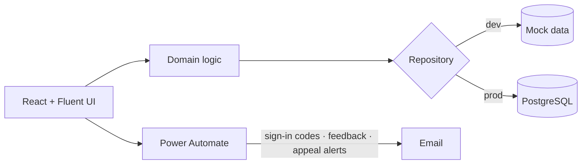

# ✅ QA Auditing Platform

> A Scalify Panama solution that digitizes quality-assurance audits for contact-center operations: scoring, appeals, feedback and client reporting.

| | |
|---|---|
| **Type** | Enterprise web app (Microsoft Power Apps **Code App**) |
| **Status** | 🟢 In production at a BPO / contact-center operation since November 2026 |
| **Users** | QA auditors, team leads, managers, admins |
| **My role** | Solution designer, full-stack developer, database designer |
| **Source** | Private |

---

## 🎯 The problem
QA audits were spread across several older canvas apps and manual spreadsheets. Scorecards weren't versioned, agents had no formal way to dispute a score, and weekly client reports were assembled by hand.

## ✅ The solution
- **Versioned scorecards** per client and task, maintained by managers inside the app.
- An **audit workflow**: auditors score an interaction, and scores roll up into agent and team summaries.
- **Appeals**: the agent requests a review, a lead reviews it, and QA decides, with the option to re-score.
- **Weekly feedback emails** in **English and Spanish**, with an HTML body and a generated PDF attachment.
- **Branded Excel client reports**, generated in one click.
- **Passwordless sign-in**: a 6-digit code sent by email, built as a reusable module for other apps.

---

## 🧱 Architecture

```
app/
├── src/
│   ├── screens/        audit · appeals · feedback · reports · admin
│   ├── domain/         Pure business logic: scoring, permissions, appeals,
│   │                   scorecard editor, weekly feedback, week math
│   ├── data/           Repository pattern with mock and live implementations
│   │   ├── mock/       Local dev with no backend (dev:mock mode)
│   │   └── powerapps/  Live connectors through the Power Apps SDK
│   ├── auth/           Session, route guards
│   ├── signin/         Reusable passwordless sign-in module
│   ├── reports/        Excel report (ExcelJS) and feedback PDF (jsPDF)
│   └── theme/          Fluent UI theming, light and dark mode
db/
├── migrations/         14 numbered PostgreSQL migrations
├── rollback/           A rollback script for each migration
├── checks/  seed/      Pre-checks, grants, smoke tests, seed data
└── RUNBOOK             Step-by-step deployment guide
docs/                   User guide, security overview, feature specs
```



---

## 🛠️ Tech stack

| Area | Tech |
|---|---|
| Front end | React 19, TypeScript, Vite 7, Fluent UI v9, TanStack Query, React Router |
| Platform | Microsoft Power Apps Code Apps (Power Apps SDK, `pac` CLI) |
| Database | PostgreSQL with triggers, pgcrypto AES-256 field encryption |
| Automation | Power Automate (sign-in codes, weekly feedback, appeal notifications) |
| Reporting | ExcelJS, jsPDF, HTML email templates |
| Quality | Vitest unit tests next to the code, ESLint |

## 💡 Engineering highlights
- **Append-only audit and change logs**, enforced by database triggers rather than application code.
- **Field-level encryption** for potentially sensitive data, documented in a security overview written for Compliance.
- **A rollback script for every migration**, plus pre-checks and smoke tests, so releases can be undone.
- **Mock/live repository switch**, so the app can be developed and demoed without touching production data.

---

## 📸 Screenshots

> Demo / mock data only.

*Screenshots coming soon.*

<!-- To show screenshots: add the images to ./screenshots, then remove this comment wrapper.
| Audit form | Scorecard editor | Appeals | Client report |
|---|---|---|---|
|  |  |  |  |
-->
