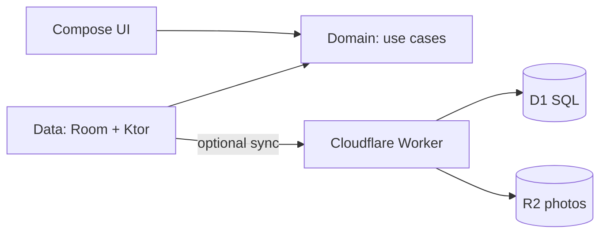

# 📱 ShopIQScan

> **Scan it. Log it. Know where it's cheaper.**
> An offline-first Android app that tracks grocery prices across stores and tells you when an item is cheaper somewhere else.

| | |
|---|---|
| **Type** | Android app + optional cloud sync API (SaaS product) |
| **Status** | Beta: signed release builds tested on real devices, Play Store listing in preparation |
| **Market** | Shoppers in Panama (Spanish UI, ITBMS tax handling, USD in cents) |
| **My role** | Product owner, Android developer, backend developer, brand designer |
| **Source** | Private (commercial product) |

---

## 🎯 The problem
Grocery prices for the same item vary a lot between stores, and nobody remembers what they paid last week. Price-comparison apps usually need constant connectivity and depend on data that someone else curates.

## ✅ The solution
- **Scan a barcode** with the camera and log the price you see on the shelf.
- Prices are **append-only observations**: history is never overwritten, so you can see how prices change over time.
- The app **warns you when an item is cheaper at another store** you've logged.
- It works **100% offline**. Signing in with Google turns on optional cloud sync and photo backup.

---

## 🧱 Architecture

```
ShopIQScan/
├── app/                      Android app (Kotlin)
│   ├── ui/                   Jetpack Compose screens, components, navigation, theme
│   │   └── feature/*         One package per feature screen
│   ├── domain/               Pure Kotlin: models, repository interfaces, use cases
│   │   └── usecase/          for example the 'cheaper elsewhere' price comparison
│   ├── data/
│   │   ├── local/            Room database, DAOs, entities, versioned migrations
│   │   ├── remote/           Ktor HTTP clients for the auth, sync and photo APIs
│   │   ├── sync/             Sync engine, coordinator and WorkManager scheduler
│   │   ├── auth/             Google sign-in (Credential Manager), local-data claim
│   │   └── image/            Item photo storage
│   ├── core/                 Money (integer cents), units of measure, price age
│   └── di/                   Koin dependency injection
├── backend/                  Optional sync API (TypeScript)
│   ├── src/routes/           auth · sync · photos · health
│   ├── src/auth/             JWT sessions (jose)
│   ├── src/db/  src/storage/ Cloudflare D1 (SQL) and R2 (photos)
│   ├── migrations/           Numbered D1 SQL migrations
│   └── scripts/              Smoke tests
├── brand/                    Brand kit + Python generators (brand book, Play assets)
└── docs/                     Functional spec, data model, architecture, roadmap, releases
```

**Dependency rule:** `ui → domain ← data`. The domain layer knows nothing about Android, Room or the network.



---

## 🛠️ Tech stack

| Layer | Tech |
|---|---|
| UI | Jetpack Compose, Material 3, type-safe Navigation Compose, Coil |
| Local data | Room (schema v4 with migration tests), DataStore |
| Device | CameraX, ML Kit barcode scanning, WorkManager |
| DI & networking | Koin, Ktor client |
| Auth | Credential Manager + Google Sign-In, JWT sessions |
| Backend | Cloudflare Workers, D1, R2, TypeScript |
| Build & CI | Kotlin 2.4, AGP 9.4, compileSdk 37, minSdk 26, R8 signed releases, GitHub Actions |

## 💡 Engineering decisions
- **Barcode as the primary key.** The same product means the same item everywhere.
- **Money as integer cents.** No floating-point rounding errors on prices or tax.
- **Append-only price history.** Every price is a dated observation, which keeps comparisons honest.
- **Additive sync.** The phone stays the source of truth, and sync never deletes local data.
- **Tested migrations.** Every Room schema change ships with a migration test.
- **Continuous integration.** GitHub Actions runs the unit tests and a debug build on every push and pull request, and type-checks the sync API. No secrets are needed, because a fresh clone builds with every remote feature switched off.

---

## 📸 Screenshots

*Screenshots coming soon.*

<!-- To show screenshots: add the images to ./screenshots, then remove this comment wrapper.
| Scan | Item & price history | Cheaper elsewhere | Settings |
|---|---|---|---|
|  |  |  |  |
-->
